 

 

## `//` whoami

Me interesa entender cómo se rompen los sistemas para saber protegerlos. Practico en laboratorios de pentesting, documento cada máquina como un cuaderno de campo en **[vklf.es](https://vklf.es)** y ahora también enseño lo que aprendo: soy profesor en la academia donde me formé en hacking ético.

 

## `//` certificación

 

## `//` arsenal

**`> hacking & seguridad`**

<code>reconocimiento</code> · <code>enumeración</code> · <code>OSINT</code> · <code>escalada de privilegios</code> · <code>criptografía</code> · <code>CTF</code>

  

**`> sistemas & redes`**

  

**`> desarrollo & datos`**

  

**`> inteligencia artificial`**

 

## `//` trayectoria

 

## `//` últimos writeups

| Máquina | Plataforma | Sistema | Vector de ataque |
| :-- | :-- | :-- | :-- |
| **[Dancing](https://vklf.es/writeup/dancing/)** | Hack The Box | Windows | SMB con acceso anónimo a recursos compartidos |
| **[Fawn](https://vklf.es/writeup/fawn/)** | Hack The Box | Linux | FTP con autenticación anónima |
| **[Meow](https://vklf.es/writeup/meow/)** | Hack The Box | Linux | Telnet con root sin contraseña |

Todos los writeups, paso a paso, en <a href="https://vklf.es/writeups/">vklf.es/writeups</a>.

 

## `//` actividad

 

