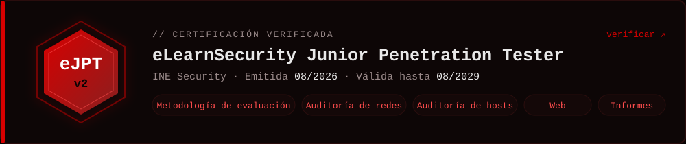
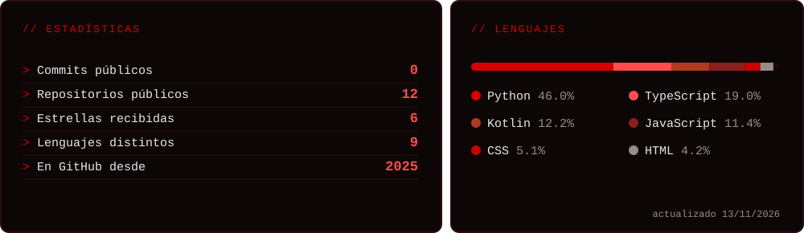

 

🔐 **Pentester junior**: rompo sistemas para aprender a protegerlos

🏴‍☠️ **eJPTv2** certificado por INE Security

🎓 **Profesor de ciberseguridad** en LionxSecurity

🛡️ **Cibercooperante** del INCIBE

🎯 **CTF Player** en Hack The Box

📝 **Writeups** paso a paso en [vklf.es](https://vklf.es)

 

### 🔴 Seguridad ofensiva

### 🖥️ Sistemas y redes

### 💻 Lenguajes y desarrollo

  

